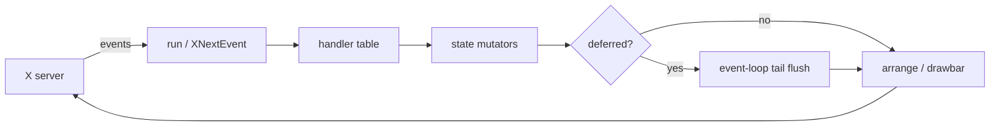
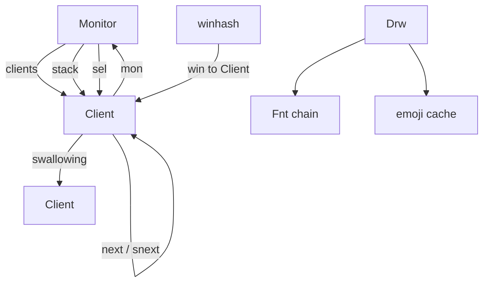
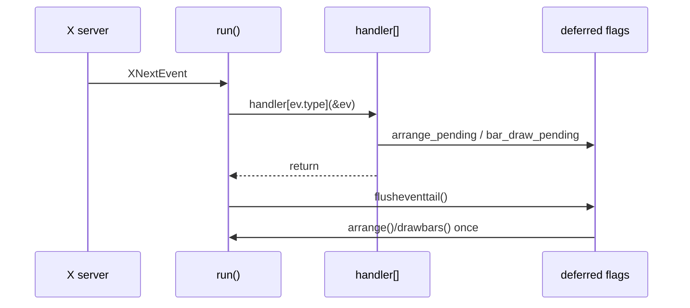
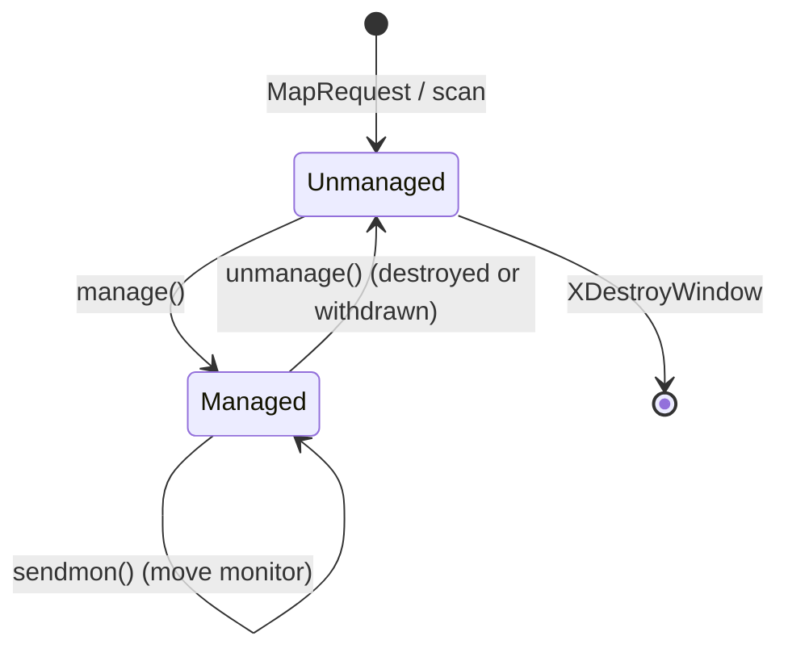
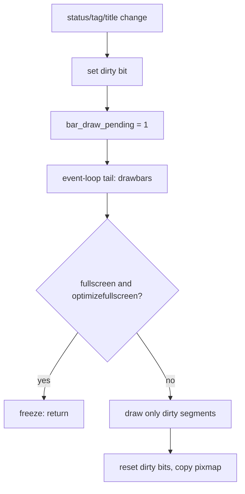

# dwm Architecture Specification

Status: living document. This is the **architecture contract** for this dwm
tree. Unit tests refer to individual function contracts through the
`@anchor spec_<function>` markers in the source; integration tests refer to the
subsystem sections below. When behavior and this document disagree, the code
is the current truth and this document must be corrected in the same change.

- Function contracts: `dwm.c`, `drw.c`, `util.c`, and the public headers.
- Subsystem contracts: this file.
- Test evidence: `tests/unit/src/` (white-box suites) with fixtures in
  `tests/unit/include/`; integration suites under `tests/unit/src/integration/`.

## 1. How to use this specification

| Audience | Entry point |
|---|---|
| Unit test author | The `@anchor spec_<function>` Doxygen block above the function definition |
| Integration test author | The subsystem section in this document, then the anchors it lists |
| Reviewer | `make spec-check` traceability output, then the mapped tests |

Traceability rules:

1. Every function definition has exactly one `@anchor spec_<function>`.
2. A unit test file named `<function>.c` verifies the function whose anchor is
   `spec_<function>`. A test for a macro or aggregate lives in an
   appropriately named file and cites the anchor in a comment.
3. Every subsystem section below lists the anchors that implement it and the
   tests that exercise it. New behavior must update the section, the anchor,
   and a test together.

## 2. Documentation conventions

Function contracts use Doxygen tags, not prose-only comments:

```c
/**
 * @brief Imperative one-line summary of the observable effect.
 *
 * Algorithm or invariant that is not obvious from the signature.
 *
 * @param[in]     c  Client; must be linked into c->mon->clients.
 * @param[in,out] x  Rectangle; clamped in place.
 *
 * @return Non-zero when the geometry changed.
 * @retval 0  No change or ignored input.
 * @retval 1  Geometry was modified.
 *
 * @pre  selmon != NULL and points at a live Monitor.
 * @post On success, *w >= c->minw and *h >= c->minh.
 * @note Reads/writes selmon, mons and bar_draw_pending; no X calls.
 * @warning Does not take ownership of c.
 * @see arrange, updategeom
 * @anchor spec_focus
 */
```

Rules:

- `@brief`, every parameter, and (for non-void functions) `@return` are
  mandatory. `@anchor spec_<function>` is mandatory and unique.
- `@pre`/`@post` describe guarantees the code actually enforces, not wishes.
- `@note` names global state and X11/Xft side effects.
- `@warning` names ownership, lifetime, and NULL hazards.
- Stable IDs are anchors, **not line numbers**. Test comments must not cite
  `dwm.c:<line>`; cite `@ref spec_<function>` instead.
- Entities that are not C functions (macros, structs, files) use `@defgroup`
  or `@anchor spec_<name>` on the declaration.

## 3. System overview

dwm is an event-driven X11 window manager. It selects
`SubstructureRedirectMask` on the root window, which makes it the sole
authority for mapping and configuring top-level windows. Each top-level,
non-`override_redirect` window becomes a `Client` owned by exactly one
`Monitor`.



Key modules:

| Module | Responsibility | Anchors |
|---|---|---|
| `dwm.c` | Event loop, client/monitor/tag/layout state, bar | `spec_run`, `spec_manage`, `spec_unmanage`, `spec_arrange`, `spec_drawbar` |
| `drw.c` | Xft drawing, glyph/emoji caches, UTF-8 | `spec_drw_create`, `spec_drw_text`, `spec_glyph_getwidth` |
| `util.c`/`util.h` | Allocation, death, number/string helpers | `spec_ecalloc`, `spec_die`, `spec_numpcpy_unsafe` |

## 4. Data model



### 4.1 Monitor

A `Monitor` represents a work area. Fields that form the contract:

- `clients` — all managed clients, in management order.
- `stack` — focus/stacking order, most recently focused first.
- `sel` — selected client, or `NULL`.
- `tagset[2]`/`seltags` — current view; `ISVISIBLE(c)` is
  `c->tags & c->mon->tagset[c->mon->seltags]`.
- `lt[2]`/`sellt` — previous/current layout.
- `gap` — inner/outer gap state (`isgap`, `realgap`, `gappx`).
- `bar_exposed`, `bar_dirty_segments` — bar invalidation state (section 9).

Contract: every client in `clients` has `c->mon == m`; every monitor is in the
global `mons` list; exactly one monitor is `selmon`.

### 4.2 Client

A `Client` owns one X window. Contract:

- `win` is the top-level window; `bw` is its border width.
- `tags` is a non-zero bitmask masked to `TAGMASK` (see `applyrules`).
- `next` links the monitor's `clients` list; `snext` links the `stack` list.
- `swallowing` points at the terminal's child client, if any.
- Geometry fields (`x`, `y`, `w`, `h`) are the last applied geometry;
  `oldx`/`oldy`/`oldw`/`oldh` are the pre-fullscreen/floating geometry.
- Size hints are cached in `base*`, `inc*`, `min*`, `max*`, `mina`, `maxa`,
  and are valid only when `hintsvalid` is set.

Contract: a client is reachable from `mon->clients` **and** `winhash` while
managed; `unmanage` removes it from both.

### 4.3 Window hash

`winhash` maps `Window` to `Client*` with open addressing and linear probing.
`winclient_put` inserts, `winclient_remove` deletes, `wintoclient` looks up.
When the table saturates (`winhash_overflowed`) inserts are suppressed and
lookups fall back to walking `mons`, so overflow degrades to O(n) but never
returns a wrong client. See `spec_winclient_put`, `spec_winclient_remove`,
`spec_wintoclient`, and `tests/unit/src/integration/integration_stress_winhash.c`.

### 4.4 Drawing context

`Drw` owns the drawable, GC, active scheme, font chain, and the emoji pixmap
cache. The `Fnt` chain provides fallback fonts. The emoji cache key is
`(codepoint, fg, bg)`; entries are invalidated on font change, `drw_resize`,
and `drw_free`.

## 5. Event loop and dispatch



Contract:

- `handler[LASTEvent]` maps event types to handlers; unhandled types have
  `NULL`.
- While `dispatching` is set, `arrange()` and bar draws may be coalesced:
  `arrange()` sets `arrange_pending`, `drawbar()` sets `bar_draw_pending`,
  and the tail of the event loop flushes them once.
- `pointergrab` (inside `movemouse`/`resizemouse`) forces immediate reflow.
- `running == 0` ends the loop; `restart` requests an `execvp` restart.

Anchors: `spec_run`, `spec_flusheventtail`, `spec_arrange`,
`spec_arrangenow`, `spec_arrangemon`, `spec_drawbar`, `spec_drawbars`.

Tests: `tests/unit/src/integration/integration_optimize_layout.c`,
`integration_events.c`, `tests/unit/src/dwm/run.c`,
`tests/unit/src/dwm/arrange.c`, `arrangenow.c`, `arrangemon.c`.

## 6. Client lifecycle



### 6.1 manage

`manage` is the single entry point for adopting a window:

1. Fetch attributes and create the `Client`.
2. Reject windows already managed.
3. Fill name, hints, tags, geometry, border width.
4. `applyrules` and `applysizehints`.
5. Insert into `clients`, `stack`, and `winhash`.
6. Grab buttons/keys, update the client list, arrange, focus.

Contract: on return the client is fully linked and visible if its tags
intersect the current view. Anchors: `spec_manage`, `spec_applyrules`,
`spec_applysizehints`, `spec_updatesizehints`, `spec_updatetitle`,
`spec_updatewindowtype`, `spec_updatewmhints`, `spec_setclientstate`.

Tests: `tests/unit/src/dwm/manage.c`, `applyrules.c`, `applysizehints.c`,
`tests/unit/src/integration/integration_window_ops.c`,
`integration_comprehensive.c`.

### 6.2 unmanage

`unmanage` is the inverse of `manage`:

1. Unswallow children, clear fullscreen, remove from `clients`, `stack`,
   `winhash`.
2. Release grabs, restore focus, free the `Client`.
3. If `destroyed == 0`, re-scan the tree; update the client list and arrange.

Contract: no dangling pointer remains in `clients`, `stack`, `winhash`,
`selmon->sel`, or `bar` state. Anchors: `spec_unmanage`,
`spec_unswallow`, `spec_detach`, `spec_detachstack`,
`spec_winclient_remove`.

Tests: `tests/unit/src/dwm/unmanage.c`, `unswallow.c`, `detach.c`,
`detachstack.c`, `tests/unit/src/integration/integration_window_ops.c`.

### 6.3 swallowing

A terminal client can own a child client via `swallowing` /
`c->swallowing`. `swallow` hides the parent, records the child, and marks the
title segment dirty; `unswallow` restores the parent and destroys the child.
Contract: a child is never both managed and swallowed. Anchors:
`spec_swallow`, `spec_unswallow`, `spec_termforwin`, `spec_swallowingclient`.

Tests: `tests/unit/src/dwm/swallow.c`, `unswallow.c`, `swallowingclient.c`,
`termforwin.c`, `tests/unit/src/integration/integration_comprehensive.c`.

## 7. Tags and rules

- Tags are bits in `unsigned int tags[]` from `config.h`; `TAGMASK` bounds
  them. `ISVISIBLE(c)` compares `c->tags` with the current view.
- `view`/`toggleview` change `seltags`; `tag`/`toggletag` change client tags.
- `toggletag` never XORs a client to zero tags: it preserves the last tag.
- `tagmon` moves a client to another monitor and follows with `sendmon`.
- `applyrules` matches `class`, `instance`, and `title` substrings; the first
  matching rule sets each field, and tags are OR-ed across matches.

Anchors: `spec_applyrules`, `spec_view`, `spec_toggleview`, `spec_tag`,
`spec_toggletag`, `spec_tagmon`, `spec_sendmon`, `spec_isvisible` (macro).

Tests: `tests/unit/src/integration/integration_pure_logic.c`,
`integration_comprehensive.c`, `tests/unit/src/dwm/applyrules.c`, `view.c`,
`tag.c`, `toggletag.c`, `toggleview.c`, `tagmon.c`, `sendmon.c`, `isvisible.c`.

## 8. Layout and geometry

- `tile` lays out the master area (`nmaster`, `mfact`) and the stack area,
  honoring gaps; `monocle` gives every visible client the full work area.
- `arrange` runs the selected layout for every monitor; `arrangemon` runs it
  for one monitor; `arrangenow` bypasses coalescing.
- `applysizehints` clamps to ICCCM hints (base, min, max, aspect, increment)
  and to the monitor work area; `interact` selects full-screen vs work-area
  bounds for mouse-driven resizes.
- `setmfact` rejects values outside `[0.05, 0.95]`; absolute mode uses
  `arg->f - 1.0`.
- `setgaps` toggles (no arg), adjusts by delta, clamps to non-negative, and
  resets to `GAP_RESET`; `gap_copy` copies gap state.
- `resize`/`resizeclient` apply geometry; `resizeclient` clamps and stores.
- `zoom` swaps the selected client with the top of the stack.

Anchors: `spec_tile`, `spec_monocle`, `spec_arrange`, `spec_arrangemon`,
`spec_arrangenow`, `spec_applysizehints`, `spec_setmfact`, `spec_setgaps`,
`spec_gap_copy`, `spec_resize`, `spec_resizeclient`, `spec_zoom`,
`spec_incnmaster`.

Tests: `tests/unit/src/dwm/tile.c`, `monocle.c`, `applysizehints.c`, `setmfact.c`,
`setgaps.c`, `gap_copy.c`, `resize.c`, `resizeclient.c`, `zoom.c`,
`incnmaster.c`, `tests/unit/src/integration/integration_arrange.c`,
`integration_optimize_layout.c`, `integration_pure_logic.c`.

## 9. Bar rendering and dirty-segment pipeline

The bar is rendered into an off-screen `Drw` pixmap and blitted to each
monitor's `barwin`. Per-monitor state:

- `bar_dirty_segments` — `DIRTY_STATUS | DIRTY_TAGS | DIRTY_TITLE`.
- `bar_exposed` — a real `Expose` invalidated the pixmap.
- `bar_draw_pending` — a deferred draw requested during event dispatch.



Contract details:

- `DIRTY_STATUS` always implies `DIRTY_TITLE` because status width moves the
  title boundary.
- `focus` sets `DIRTY_TITLE|DIRTY_TAGS` only when the selection changes.
- `setlayout` sets `DIRTY_TAGS`; `togglebar` sets all three.
- `propertynotify` maps `WM_HINTS` to `DIRTY_TAGS` and `WM_NAME` to
  `DIRTY_TITLE` (selected client only).
- `drawbar` reads `drw->fonts->h` before its early returns, so `drw` must have
  a valid font chain even when nothing is drawn.
- Under `DWM_TEST` the mask is not cleared after a draw so tests can observe
  it.
- When a fullscreen client is selected and `optimizefullscreen` is set,
  `drawbar` returns without drawing; `setfullscreen(c, 0)` must force a full
  redraw with `DIRTY_ALL`.

Anchors: `spec_drawbar`, `spec_drawbars`, `spec_updatestatus`,
`spec_setlayout`, `spec_togglebar`, `spec_focus`, `spec_propertynotify`,
`spec_expose`, `spec_setfullscreen`.

Tests: `tests/unit/src/integration/integration_segments.c` (strongest evidence),
`integration_events.c`, `tests/unit/src/dwm/drawbar.c`, `drawbars.c`,
`updatestatus.c`, `setlayout.c`, `togglebar.c`, `expose.c`.

## 10. Fullscreen and process control

`setfullscreen` enters/exits fullscreen, saves and restores geometry and
border width, removes/adds decorations, and drives the process-control seam:

- `killall(name, signal)` invokes `killall_impl` (indirection for tests).
- `killatfullscreen_stop` sends `-STOP` to each configured target.
- `killatfullscreen_resume` sends `-CONT`.
- `killatfullscreen_start` sends `-CONT` then `-HUP` in that order.
- Under `DWM_TEST` the start body runs synchronously.

Contract: enter fullscreen stops targets once; exit resumes them; repeated
enter is idempotent. Anchors: `spec_setfullscreen`, `spec_killall`,
`spec_killatfullscreen_stop`, `spec_killatfullscreen_start`,
`spec_killatfullscreen_resume`, `spec_isanyfullscreen`, `spec_sighup`,
`spec_sigterm`, `spec_spawn`.

Tests: `tests/unit/src/integration/integration_process_control.c` (call-order
assertions), `tests/unit/src/dwm/setfullscreen.c`, `killall.c`,
`killatfullscreen_stop.c`, `killatfullscreen_start.c`,
`killatfullscreen_resume.c`, `sighup.c`, `sigterm.c`, `spawn.c`.

## 11. X11 ownership, focus, grabs, and errors

- `focus` selects a client or resolves one from `stack`; it unfocuses the old
  selection, moves the new one to the top of `stack`, re-grabs buttons, sets
  the border, and sets X input focus. With no client, focus reverts to root
  and `_NET_ACTIVE_WINDOW` is deleted.
- `unfocus` clears selection state and optionally resets X focus.
- `focusin` ignores `NotifyInferior` and own-window events.
- `focusmon`/`focusstack` move selection across monitors/clients.
- `grabkeys`/`grabbuttons` install grabs for every key/button binding,
  including NumLock/CapsLock modifier variants.
- `xerror` swallows known non-fatal errors (`BadWindow`, `BadMatch`, etc.);
  `xerrorstart` aborts if another WM is running.
- `getatomprop`, `getstate`, `gettextprop`, `updatenumlockmask` wrap X
  property/modifier queries.

Anchors: `spec_focus`, `spec_unfocus`, `spec_setfocus`, `spec_focusin`,
`spec_focusmon`, `spec_focusstack`, `spec_grabkeys`, `spec_grabbuttons`,
`spec_xerror`, `spec_xerrorstart`, `spec_getatomprop`, `spec_getstate`,
`spec_gettextprop`, `spec_updatenumlockmask`, `spec_updategeom`,
`spec_isuniquegeom`.

Tests: `tests/unit/src/dwm/focus.c`, `unfocus.c`, `setfocus.c`, `focusin.c`,
`focusmon.c`, `focusstack.c`, `grabkeys.c`, `grabbuttons.c`, `xerror.c`,
`getatomprop.c`, `getstate.c`, `gettextprop.c`, `updatenumlockmask.c`,
`updategeom.c`, `isuniquegeom.c`, `tests/unit/src/integration/integration_events.c`,
`integration_coverage_gaps.c`.

## 12. Drawing library

`drw.c` is a thin, testable layer over Xlib/Xft:

- `drw_create`/`drw_resize`/`drw_free` manage the pixmap, GC, and XftDraw.
- `drw_rect` fills/clears rectangles; `drw_text` renders UTF-8 with padding,
  ellipsis, fallback fonts, and the emoji cache; `drw_map` copies the pixmap
  to a window.
- `glyph_getwidth` caches non-ASCII widths; `drw_fontset_getwidth_clamp`
  bounds a measurement.
- `utf8decode`/`utf8decodebyte`/`utf8validate` implement strict UTF-8.
- The emoji cache (`emoji_cache_*`) stores rendered pixmaps keyed by
  `(codepoint, fg, bg)` and is invalidated on resize/font change/free.

Anchors: `spec_drw_create`, `spec_drw_resize`, `spec_drw_free`,
`spec_drw_rect`, `spec_drw_text`, `spec_drw_map`, `spec_drw_fontset_create`,
`spec_drw_fontset_getwidth`, `spec_drw_fontset_getwidth_clamp`,
`spec_glyph_getwidth`, `spec_emoji_cache_lookup`, `spec_emoji_cache_insert`,
`spec_emoji_cache_invalidate`, `spec_utf8decode`, `spec_utf8decodebyte`,
`spec_utf8validate`.

Tests: `tests/unit/src/drw/*.c`, `tests/unit/src/integration/integration_drw_safety.c`.

## 13. Test architecture and known blind spots

Most correctness tests are white-box unit tests: they include
`dwm.c`/`drw.c`/`util.c` and link against `tests/mock_x11.c` and
`tests/mock_drw.h`. `tests/test-e2e.sh` adds an Xvfb smoke test against an
ASan+UBSan `dwm` build (tiling, tags, fullscreen, `XKillClient`) and skips
when `Xvfb`/`xdotool`/`xwininfo` are unavailable. Consequences, which this
document must not hide:

- The mock records the main X side effects (`XMapWindow`, `XUnmapWindow`,
  `XMoveWindow`, `XMoveResizeWindow`, `XResizeWindow`, `XRaiseWindow`,
  `XConfigureWindow`, `XSetWindowBorder*`, `XSetInputFocus`,
  `XChangeProperty`, `XDeleteProperty`, `XSendEvent`, `XKillClient`,
  `XRefreshKeyboardMapping`, and grab/ungrab counts) in `MockXCall`
  recorders; tests must assert on these, not just call the function.
- Xft is a stateful fake: `XftFontOpenName`/`XftFontOpenPattern` return
  deterministic fonts (ascent 11, descent 4), `XftTextExtentsUtf8` advances
  `mock_xft_advance` pixels per byte, and `XftCharExists` honours
  `mock_xft_missing_codepoint`/`mock_xft_font_fail`. This exercises the real
  `drw_text`, `drw_fontset_getwidth`, `glyph_getwidth`, `drw_rect`, and
  `drw_map` paths. No real glyph rasterization or emoji PNG decode occurs.
- `XGetWindowProperty`, transient hints, and window attributes still ignore
  the window argument (one global control value for all windows), so
  per-window and cross-window behavior is not faithfully modeled.
- `fork` is mocked, so `spawn`/`killall` child behavior is simulated.
- Tests compile with `-DDWM_TEST`, which changes `drawbar` dirty-bit clearing
  and makes `killatfullscreen_start` synchronous.
- Only `tests/unit/src/dwm/isuniquegeom.c` defines `XINERAMA`, while production
  builds with `-DXINERAMA`.

A test may be green while a specification requirement is under-specified; the
mitigation is mock call recording plus the real-X E2E smoke suite.
Sanitizer runs (`make asan-ubsan`, `make tsan-ubsan` under `tests/`) build each
configuration into its own directory and currently pass the full suite; they
caught the `0xff << 24` signed-shift UB in `drw_clr_create` and an
out-of-bounds `scheme[ColBorder]` fixture allocation in
`integration_coverage_gaps`. A review of the new Xft fake also found and fixed
an infinite fallback loop in `drw_text` when `XftFontMatch` returns NULL.
Property/fuzz tests now cover UTF-8 decoding/validation (round-trip and
arbitrary byte windows), `keyset_put`/`iskeybound` (model comparison and
saturation fallback), and `applysizehints` (bounds and idempotence under 500
randomized hint sets). Those tests also exposed non-standard modifier-mask
constants in the mock (`Mod2Mask` duplicated `Mod1Mask`, `Mod4Mask`/`Mod5Mask`
were shifted); they now match X11. The Clang integer sanitizer runs into its
own build tree and allowlists only intentional wraparound (hash functions,
`util.h` range-check macros, test PRNGs); it found no unexpected diagnostics.
`make -C tests coverage-check` enforces 95%/80%/85% line-coverage floors for
`dwm.c`/`drw.c`/`util.c`, and `.github/workflows/test.yml` runs the whole
matrix plus spec/docs/coverage gates on every push and PR.
See `CODEBASE-REVIEW.md` for the current gap list.

## 13a. Explicit state machines

Several previously implicit machines are now explicit in code:

| Machine | State type | Single writer / helper |
|---|---|---|
| Process lifecycle | `LifecycleState` (`dwm.h`) | `quit()` (`spec_quit`) |
| Mouse drag | `DragPhase` / `DragState` (`dwm.c`) | `drag_begin()` / `drag_end()` (`spec_drag_begin`, `spec_drag_end`) |
| Fullscreen processes | `ProcessState` + `fs_epoch` (`dwm.h`) | `killatfullscreen_stop/start/resume` |
| Client lifecycle | `ClientState` + `holder` (`dwm.h`) | lifecycle call sites in `manage`, `swallow`, `unswallow`, `unmanage` |
| Bar rendering | `BarState` + `DIRTY_ALL` (`dwm.h`) | `bar_mark_dirty()` (`spec_bar_mark_dirty`) |
| Geometry reprobe | `GeomChange` (`dwm.h`) | `updategeom()` populates `lastgeom` |
| X errors | scoped guard | `error_guard_begin/end()` |

Conventions: a state transition must go through the named helper; never mix a
raw field write with a helper call for the same state. Tests for each helper
live in `tests/unit/src/dwm/<function>.c`.

## 14. Traceability matrix

| Subsystem | Primary anchors | Strongest tests |
|---|---|---|
| Event loop / coalescing | `spec_run`, `spec_flusheventtail`, `spec_arrange` | `integration_optimize_layout.c` |
| Client lifecycle | `spec_manage`, `spec_unmanage`, `spec_winclient_put` | `integration_window_ops.c`, `integration_stress_winhash.c` |
| Tags / rules | `spec_applyrules`, `spec_view`, `spec_toggletag` | `integration_pure_logic.c` |
| Layout / geometry | `spec_tile`, `spec_monocle`, `spec_applysizehints` | `integration_arrange.c`, `unit/src/dwm/applysizehints.c` |
| Bar / dirty segments | `spec_drawbar`, `spec_updatestatus`, `spec_setlayout` | `integration_segments.c` |
| Fullscreen / processes | `spec_setfullscreen`, `spec_killall` | `integration_process_control.c` |
| Focus / X11 | `spec_focus`, `spec_setfocus`, `spec_xerror` | `unit/src/dwm/xerror.c`, `integration_events.c` |
| Drawing / caches | `spec_drw_text`, `spec_glyph_getwidth`, `spec_emoji_cache_insert` | `unit/src/drw/*`, `integration_drw_safety.c` |

## 15. Change protocol

1. Change behavior only together with its `@anchor` contract.
2. Add or update the mapped unit test; if the behavior is a subsystem
   invariant, add an integration test and update this document.
3. Run `make -C tests test` and `make -C tests asan`.
4. Run `make spec-check` to confirm every anchor is unique and every unit
   test names an existing anchor; run `make docs` to regenerate the HTML.
5. Update `AGENTS.md` if the test inventory or workflow changed.
